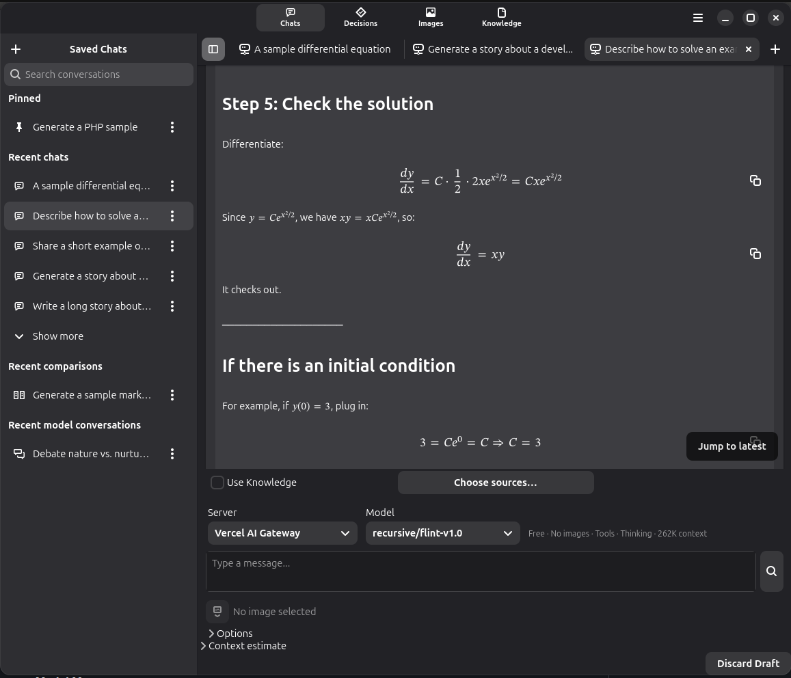

<div align="center">

# Tureen

</img>

**Native GNOME client for local and cloud AI**

[Ollama](https://ollama.com), [LM Studio](https://lmstudio.ai), [Ubuntu Inference Manager](https://github.com/canonical/inference), [OpenAI](https://openai.com), [OpenRouter](https://openrouter.ai), the [Vercel AI Gateway](https://vercel.com/ai-gateway), and more.<br>
Chat, compare models, generate images, and create local RAG collections.

*Formerly known as Gnollama.*
</div>

## Description

**Tureen** is a native GNOME client for local and cloud AI models. It brings many model providers together in one responsive Linux desktop app: chat with any of them, compare their answers side by side, let two models talk to each other, generate images, and ground answers in local RAG collections built from your own documents.

Whether you are developing, experimenting, or chatting with local models, Tureen makes it easy to run prompts across multiple local or remote hosts simultaneously.

## Features



### Hosts and providers

Connect to any mix of local and cloud hosts, and pick a different one in every tab.

- Local servers: Ollama, LM Studio, Ubuntu Inference Manager, and other OpenAI-compatible servers
- Cloud services: Ollama Cloud, OpenAI, OpenRouter, and the Vercel AI Gateway
- API keys kept in the desktop keyring, never in the database or exports
- Each model's capabilities (vision, tools, thinking) checked before sending
- Pull, inspect, unload, and delete models on Ollama servers

[Read more →](documentation/hosts-and-providers.md)

### Chats and responses

- Multi-turn chats, and single responses for prompt testing
- Image attachments for vision models, including pasting from the clipboard
- Markdown, syntax-highlighted code, and typeset TeX math
- Separate thinking display, generation statistics, and logprobs
- Stop any response and keep the partial answer
- Automatic history with drafts, pinning, full-text search, and Markdown/JSON export

[Read more →](documentation/chats.md)

### Compare models

Send one prompt to 2–4 models at once, on any hosts, and read their answers side by side.

[Read more →](documentation/comparisons.md)

### Model-to-model conversations

Let two models talk to each other for up to 100 rounds, each with its own system prompt and settings, with pause, resume, and retry.

[Read more →](documentation/model-conversations.md)

### Decisions

Ask decision models yes/no, choice, score, and box questions about text, JSON, or images, and see each answer with its probabilities.

[Read more →](documentation/decisions.md)

### Image generation

Generate images from a prompt on OpenAI, OpenRouter, and the Vercel AI Gateway, with reference images and model settings.

[Read more →](documentation/images.md)

### Knowledge and RAG

- Import text, PDFs, web pages, and images into a local library
- Organize documents into collections and embed them with any host that offers embedding models
- Ground chat answers in your collections, and see exactly which passages were used
- Cosine, Euclidean, or Manhattan similarity, with exact local search through sqlite-vec

[Read more →](documentation/knowledge.md)

### Structured output and tool calling

- Ask for JSON or JSON Schema output and validate it locally
- Test tool calling with your own function definitions and mock results; nothing is ever executed

[Structured output →](documentation/structured-output.md) · [Tool calling →](documentation/tool-calling.md)

### A native GNOME app

Built with GTK4 and Libadwaita: adaptive layouts for narrow windows, separate sections for Chats, Decisions, Images, and Knowledge, keyboard shortcuts, and 14 interface languages.

See the [full documentation](documentation/README.md) for every feature in detail.

## Build

Tureen can be built and run with [GNOME Builder](https://wiki.gnome.org/Apps/Builder).

1. Open GNOME Builder
2. Click the **Clone Repository** button
3. Enter `https://github.com/jackrabbithanna/tureen.git` in the field **Repository URL**
4. Click the **Clone Project** button
5. Click the **Run** button to start building application

### Flatpak

To build Tureen from a checkout and install it as a Flatpak, add Flathub, then install flatpak-builder and the GNOME 51 SDK and runtime:

```bash
flatpak remote-add --user --if-not-exists flathub https://dl.flathub.org/repo/flathub.flatpakrepo
flatpak install --user flathub org.flatpak.Builder org.gnome.Sdk//51 org.gnome.Platform//51
```

From the root of the checkout, build and install it for your user, then run it:

```bash
flatpak run org.flatpak.Builder --user --install --force-clean --disable-rofiles-fuse \
  ~/.cache/tureen-flatpak-build io.github.jackrabbithanna.Tureen.json
flatpak run io.github.jackrabbithanna.Tureen
```

- `~/.cache/tureen-flatpak-build` is a scratch directory where the application is assembled; any path outside the checkout will do. Downloads and built modules are cached in `.flatpak-builder/` in the checkout, so later builds are faster.
- `--disable-rofiles-fuse` avoids the error "Failure spawning rofiles-fuse", which flatpak-builder often gives when it runs as a Flatpak itself. A `flatpak-builder` installed from your distribution can be used in its place.
- The installed application is also in your application menu. Remove it with `flatpak uninstall --user io.github.jackrabbithanna.Tureen`.
- GNOME Builder runs the application under the same ID and with the same data. Only one instance runs at a time: while Builder's is open, starting the installed one brings Builder's window forward instead. Run `flatpak ps` to see which is running. The installed one uses `org.gnome.Platform`, and Builder's uses `org.gnome.Sdk`.
- Runs from GNOME Builder cannot show images in formats GTK does not read itself, such as the WebP that some image models return: the sandboxed image loader cannot start there. Such an image can still be saved. The installed application shows it.

### Native build and development

To build with Meson outside Flatpak, run the tests, or learn how Tureen is put together, see [Development](documentation/development.md).

## Languages

The interface follows your desktop language. Arabic, German, Greek, Spanish,
French, Hindi, Italian, Japanese, Korean, Portuguese, Swahili, Turkish, Ukrainian,
and Simplified Chinese have complete application catalogs.
See the [translation review and maintenance guide](po/README.md) for coverage,
language selection, review findings, and translation checks.
 
## Contribute

The [GNOME Code of Conduct](https://conduct.gnome.org/) is applicable to this project


## License

Tureen is released under the terms of the [GNU General Public License V3](https://www.gnu.org/licenses/gpl-3.0.html).

No warranty provided. No guarantee it does anything at all. Use at your own risk.
