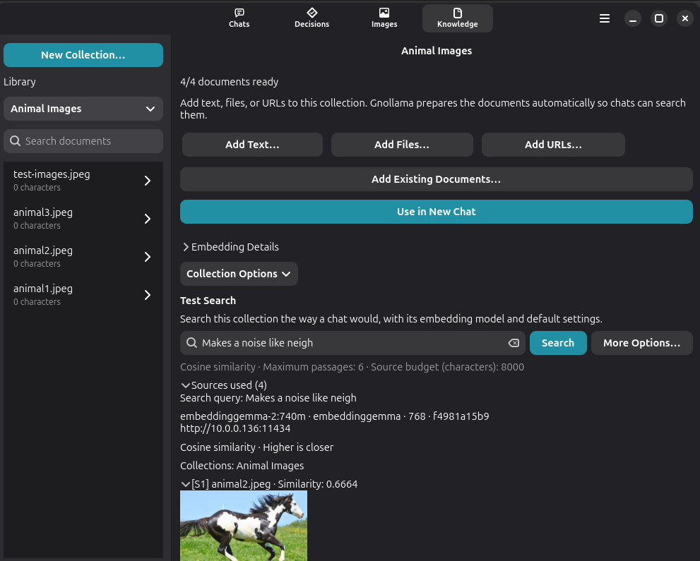
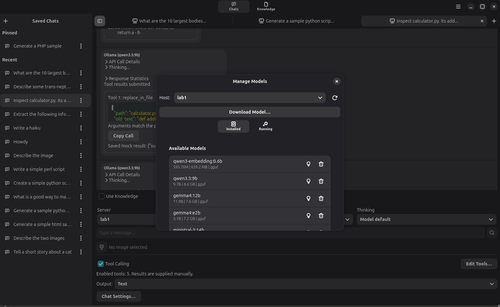

<div align="center">

# Tureen

</img>

**Native GNOME client for local and cloud AI**

[Ollama](https://ollama.com), [LM Studio](https://lmstudio.ai), [OpenAI](https://openai.com), [OpenRouter](https://openrouter.ai), the [Vercel AI Gateway](https://vercel.com/ai-gateway), and more.<br>
Chat, compare models, generate images, and create local RAG collections.

*Formerly known as Gnollama.*
</div>

## Description

**Tureen** is a native GNOME client for local and cloud AI models. It brings many model providers together in one responsive Linux desktop app: chat with any of them, compare their answers side by side, let two models talk to each other, generate images, and ground answers in local RAG collections built from your own documents.

Whether you are developing, experimenting, or chatting with local models, Tureen makes it easy to run prompts across multiple local or remote hosts simultaneously.

## Features

* **Multi-Host Management**: Connect to local or remote Ollama servers, Ollama Cloud, OpenAI, OpenRouter, the Vercel AI Gateway, LM Studio, or other OpenAI-compatible servers. Add, edit, or delete configurations, verify host status, and define a default host.
* **Generation Workflows**:
  * **New Chat (`/api/chat`)**: Multi-turn sessions that preserve conversation context.
  * **New Response (`/api/generate`)**: Single-turn completions ideal for prompt engineering and testing.
  * **Model to Model Conversation**: Alternating A/B conversations with separate system prompts, bounded rounds, pause/resume, and saved transcripts.
  * **Decision**: Ask a decision model named yes/no, choice, score, and box questions about text, JSON, or images, and read each answer with its probabilities.
  * **Image**: Generate images from a prompt, with reference images and model settings, on OpenAI, OpenRouter, and the Vercel AI Gateway.
  * Model lists appear before capability checks. Only the selected model is checked; models known to be embedding-only are excluded from all generation modes. Opening an empty selector retries discovery. Embedding models remain available in Knowledge and Manage Models; unknown capabilities remain supported for older servers.
* **Conversation History & Sidebar**:
  * Automatically saves chat logs and model configurations between runs.
  * **Pin Chats**: Pin essential conversations to the top of your history list.
  * **Popover Options**: Use a three-vertical-dots menu on any saved chat to quickly Pin, Rename, or Delete.
* **Model Manager**:
  * Pull or delete models directly from the UI.
  * View comprehensive model info, including size, parameter specifications, Modelfiles, templates, and licenses.
  * Switch between Installed and Running models for the selected host. Inspect memory, VRAM, context length, and expiry, or unload a model while keeping its downloaded files.
  * Running models refresh every five seconds while that view is visible. Unload is unavailable while Tureen has an active response using the model.
* **Structured Output**: Choose Text, JSON, or JSON Schema below the image controls in either Chat or Response tabs. Paste or import a schema, validate responses locally, and copy or save JSON. The raw response and validation result remain in saved chat history.
* **Tool Calling Playground**: Define function tools in Chat tabs, inspect model calls and argument validation, supply mock results, and continue with the current model and settings. Import/export definitions as JSON and reopen pending rounds from saved history.
* **Knowledge Library and RAG**: Import text, PDFs, web pages, and images, organize multi-document collections, create embeddings with any host that offers embedding models (see [What each host type supports](#what-each-host-type-supports)), keep the vectors in a local database, inspect them, and search selected collections using cosine, Euclidean, or Manhattan comparison. Chats retain the passages used for each answer.
  * **Add URLs**: Review batches of web pages, PDFs, or text URLs before adding them to a collection. Extract main content automatically or use a CSS selector, edit the preview, and retain source URLs in chat citations.
* **Model Lifetime**: Choose the server default, unload after a reply, five or thirty minutes, indefinitely, or a custom duration in seconds in **Chat Settings…**. This setting applies to requests from that tab.
* **Rich Markdown & Code Rendering**: Full Markdown support and code syntax highlighting (powered by GTKSourceView 5).
* **Math Rendering**: TeX in responses is typeset as equations that follow the theme's text colour and font size.
  * Display equations (`\[ … \]`, `$$ … $$`, a bare `\begin{…}` environment, or a line that is only TeX) are centred on their own line, with a button to copy the TeX source.
  * Inline equations (`\( … \)`, `$ … $`) are drawn within the text, including inside tables. Prices such as `$5` and anything in code are left as written.
  * Selecting and copying text copies a placeholder character for each inline equation rather than its TeX.
* **Multimodal Image Support**: Upload and attach multiple images to your prompts for vision-enabled models.
  * Paste a copied image, screenshot, or image file into the composer (Ctrl+V) to attach it. Clipboards that also offer plain text paste as text.
  * Models explicitly lacking vision cannot receive new attachments. Earlier images remain visible and saved but are omitted from outgoing history for those models, with a notice in the composer.
  * Hosts without capability metadata retain manual image support, marked as unknown.
* **Thinking & completion Details**:
  * Separate display of Ollama's native thinking stream, with model-dependent thinking controls.
  * Display generation stats (including cached prompt tokens, finish reason, and tokens/second) and logprobs.
* **Stop Responses**: Stop generation while keeping partial answers in chat history. Pending history writes finish before the application quits.
* **Adaptive GNOME Navigation**: The header switches between four sections: **Chats**, **Decisions**, **Images**, and **Knowledge**. Chats, Decisions, and Images each have their own tabs and their own sidebar, with its own search and its own Drafts and Pinned groups. The Chats sidebar groups Recent chats, Recent comparisons, and Recent model conversations; the Decisions sidebar lists Recent decisions, and the Images sidebar Recent images. Starting or reopening a decision or an image shows its section. Native tabs support reordering and loading indicators, and sidebars collapse on narrow windows. Ctrl+W, Ctrl+Page Up/Down, and F9 close a tab, switch tabs, and toggle the sidebar in the section shown.


### Hosts and providers

Open **Manage Hosts**, add a host, and choose its type. A host can be a server on your computer or network, or a cloud service with an API key. Select any host in a Chat, Response, Comparison, Decision, or Image tab.

| Host type | Address | API key | Where to get a key |
| --- | --- | --- | --- |
| **Ollama Server** | Your server, e.g. `http://localhost:11434` | Not needed | — |
| **LM Studio** | `http://localhost:1234` by default; enable the server in LM Studio's Developer tab | Optional | Only if you turned on authentication in LM Studio |
| **OpenAI-Compatible Server** | Your server, e.g. `http://localhost:8080` (`/v1` is added if needed) | Optional | Whatever your server expects |
| **Ollama Cloud** | Filled in automatically | Required | [ollama.com/settings/keys](https://ollama.com/settings/keys) |
| **OpenAI** | Filled in automatically | Required | [platform.openai.com/api-keys](https://platform.openai.com/api-keys) |
| **OpenRouter** | Filled in automatically | Required | [openrouter.ai/keys](https://openrouter.ai/keys) |
| **Vercel AI Gateway** | Filled in automatically | Required | Your Vercel dashboard, under **AI Gateway → API Keys** |

**Test Connection** lists the host's models. For OpenAI and the Vercel AI Gateway it also confirms the key is accepted. Ollama Cloud and OpenRouter publish their model lists, so for them a successful test confirms only that the service is reachable, and the key is checked when you first generate a response.

#### What each host type supports

| | Ollama Server | LM Studio | OpenAI-Compatible | Ollama Cloud | OpenAI | OpenRouter | Vercel AI Gateway |
| --- | :-: | :-: | :-: | :-: | :-: | :-: | :-: |
| Chat, tools, thinking | ✓ | ✓ | ✓ | ✓ | ✓ | ✓ | ✓ |
| Structured output | ✓ | ✓ | ✓ | | ✓ | ✓ | ✓ |
| Single responses (`/api/generate`) | ✓ | | | ✓ | | | |
| Embeddings for Knowledge | ✓ | ✓ | ✓ | | ✓ | ✓ | ✓ |
| Image embeddings | ✓ | | ✓ | | | ✓ | |
| Decisions | ✓ | ✓ | | | ✓ | ✓ | ✓ |
| Image generation | | | | | ✓ | ✓ | ✓ |
| Pull, delete, and unload models | ✓ | | | | | | |
| Model retention | ✓ | | | | | | |

Model names come directly from each host. Image input, tool calling, and thinking controls follow each model's reported capabilities. OpenAI-compatible servers don't report these, so Tureen doesn't check them there. If a tab uses a setting the selected host can't take, such as structured output on Ollama Cloud, Tureen names it instead of sending the request. The setting stays saved in the tab for hosts that support it.

#### API keys

Keys are stored through libsecret in the desktop keyring (using its portal backend in Flatpak), separately from the host database and conversation history. Leave the key field blank when editing to retain the existing key. If the keyring is unavailable, **Use for This Session** keeps the entered key in memory until Tureen exits. After restarting, enter it again unless a previously saved key is available. Removing a host also removes its saved key; a keyring failure leaves the host available for retry.

### Knowledge Library and RAG

1. Pick a host with an embedding model. On an Ollama server, use **Manage Models** to pull one, such as `qwen3-embedding:0.6b` or `embeddinggemma`. In LM Studio, download one in LM Studio itself. OpenAI, OpenRouter, the Vercel AI Gateway, and OpenAI-compatible servers list the embedding models they offer, such as `text-embedding-3-small`. Ollama Cloud has no embedding models. The model generating chat answers can run on a different host. Wherever the embeddings are made, the vectors and document text are stored locally in Tureen's database. With a cloud host, though, the document text and images are sent to that service to be embedded, so use a local host for anything that must stay on your machine.
2. Switch to **Knowledge**, which opens on **Collections**. Choose **New Collection…**, enter a name, and select the embedding server and model. Model-specific formatting defaults are selected automatically. Prefixes, dimensions, and chunk settings are available under **Advanced Embedding Settings**.
3. Open the collection and choose **Add Text…**, **Add Files…**, or **Add URLs…**. **Add Files…** also takes images (PNG, JPEG, GIF, WebP) when the collection's embedding model accepts them; see the image embeddings row in the host table. Every import shows its destination collection and can create a new collection without leaving the dialog. Review content, then choose **Add to Collection**. Files are reviewed one at a time in a single queue; skip unsupported files and continue with the rest.
4. Documents prepare automatically, reusing compatible embeddings. Watch document status change to **Ready**; failures show their cause and can be retried with **Prepare Documents**. **Add Existing Documents…** shares library documents across collections without duplicating their text or compatible vectors. **All Documents** and **Ungrouped Documents** remain available in the Library selector.
5. Choose **Use in New Chat** on a ready collection, or open a Chat tab’s **Choose sources…**. Select collections first; the first selection determines the embedding configuration and default server/model. Compatible collections can be combined. Server overrides, similarity measures, thresholds, and retrieval limits are under **Search Settings**; **Test Search** previews retrieval without sending a chat message.
6. Enable **Use Knowledge** in a Chat tab. Each new turn resolves the current collection membership before searching. Every selected collection must be nonempty and fully indexed; otherwise the app explains which sources need attention and keeps the draft. The expandable **Search Query Override** can make a follow-up self-contained without changing the chat message.

Collection names and membership can change. Under **Collection Options**, use **Copy with New Settings** to change a collection’s embedding model, prefixes, dimensions, or chunk settings: the original collection and chats are preserved. **Change Embedding Model** selects a model with the same identity (digest or fingerprint), including on another host that reports the same model. Removing a document from a collection or deleting a collection keeps its library documents and embeddings; deleting an individual embedding index leaves its collection membership needing a rebuild. Cancelling a shared build affects every collection using it, and interrupted builds require an explicit retry after restarting.

For a quick example, create a collection and paste: `The maintenance window is Sunday from 02:00 to 04:00 UTC. Contact the infrastructure team to request an exception.` Wait for its embeddings to complete, select the collection in a chat, and ask: `When is the maintenance window?` Expand **Sources used** to inspect the actual passage supplied to the model.

#### Importing URLs

Choose **Add URLs…**, select a destination collection, and paste up to 20 HTTP/HTTPS URLs, one per line. **Fetch URLs** downloads two pages at a time. Select a row to review its title and extracted text, then **Add to Collection**, **Skip**, or **Fetch Again** (or **Retry** after a failure). A failed URL does not stop the other pages. Saving starts the collection's embedding build; closing the dialog discards unsaved previews and cancels unfinished downloads, while saved documents remain in the library.

HTML extraction preserves a marked main/article region, removes navigation and other surrounding content, and uses Trafilatura when no main region is identified. Headings, lists, tables, links, and code are stored as Markdown. If the result needs adjustment, expand **Refine Extraction** and enter a **CSS selector**, such as `main`, `article`, `.article-body`, or `#content`, and choose **Re-extract**. Matching regions are taken in document order without repeating nested matches. You can also edit the title and text directly. Invalid selectors leave the previous preview available. PDF and UTF-8 text links use the file extractors; editing PDF text removes its original page-number mappings.

Only downloaded content is processed: there is no linked-page crawling, JavaScript execution, login session, or automatic refresh. JavaScript-only pages may require copying their text into **Add Text**. Downloads have a 60-second deadline, a five-redirect limit, and a 50 MiB limit including decompressed content. The existing text/PDF extraction limits apply. Temporary downloads use a 200 MiB batch cache; save or skip pages to free space if fetching pauses.

Web documents show their source URL, fetch date, and **Fetch Again…** action. Reimporting the same requested URL updates that document; different URLs remain independent even if their text matches. Unchanged text reuses existing vectors. Changed text requires **Replace and Rebuild** confirmation naming the affected collections. Replacement clears obsolete vectors and rebuilds the existing indexes with their original model and chunk settings. Affected collections cannot search until rebuilding succeeds; failed builds can be retried. Saved chat answers keep their original passages and source metadata. A document with queued or running embedding builds must finish those builds before it can be replaced.

An embedding configuration fixes the model's identity, vector dimensions, and document/query prefixes. Searches must use that configuration; a matching model name alone is insufficient if the identity changed. On Ollama hosts the identity is the model's content digest. Other hosts don't publish one, so Tureen uses a fingerprint of what the host reports about the model (its ID, and its variant or creation date where available). A replacement model that reports the same details would go unnoticed, and Tureen says so when you choose such a model. Built-in presets cover plain input, EmbeddingGemma retrieval, Nomic retrieval, and Qwen3 retrieval; custom prefixes are also available. The Qwen3 preset leaves documents plain and adds its retrieval instruction to queries. Existing configurations retain their saved prefixes. Dimensions must be between 1 and 8,192. Defaults are native dimensions and paragraph-aware chunks of up to 1,600 characters with 200 characters of overlap. Text that is too long for the embedding model is never silently cut short. Ollama is sent `truncate=false`, so it refuses oversized chunks, which are then split further, and the actual boundaries are saved. Other hosts would shorten long input without saying so. For them, Tureen estimates each chunk's tokens against the model's input limit, when the host reports one, and keeps a fifth of the limit in reserve. If a chunk or search query is too long, Tureen stops and asks for a smaller chunk size or a shorter query.

Retrieval defaults to six passages and an 8,000-character source budget, with no minimum similarity. These controls are separate from generation settings. Character budgets are not token limits; allow room in the chat model's context for history, tools, and the answer. Similarity is a ranking score, not confidence. The model is instructed to favor supplied sources, cite passages when the response format permits, and acknowledge missing evidence. This does not guarantee factual accuracy or citation compliance.

**Similarity measure** offers three choices:

| Measure | Closest match | Optional cutoff |
| --- | --- | --- |
| Cosine similarity (default) | Higher similarity, from −1 to 1 | Minimum similarity |
| Euclidean distance (L2) | Lower distance | Maximum distance, zero or greater |
| Manhattan distance (L1) | Lower distance | Maximum distance, zero or greater |

Switching measures clears the cutoff because its units change. Tureen stores normalized vectors, so Euclidean and cosine usually produce the same ranking; Manhattan sums absolute component differences and can produce a different ranking. The selected measure and actual scores are saved with each answer and displayed in **Sources used**. Existing snapshots without a measure are interpreted as cosine. No re-embedding or database migration is needed to switch measures.

The original prompt remains visible and saved. Exact retrieved passages, locations, scores, embedding configuration, search query, and resolved collection names/membership are saved with the turn. Collection changes affect future questions; earlier answers retain their original sources. Only that turn's reference passages are added to outgoing context. Tool-call continuations reuse the same snapshot, even after reopening the chat. JSON/JSON Schema output remains supported, with source information in a separate panel rather than additional schema fields.

If retrieval fails or selected sources disappear, the prompt remains in the composer. Adjust sources, retry, or explicitly choose **Send Without Knowledge**. Changing the selection affects subsequent user turns. Applied selections persist even in chats closed before their first prompt.

Older chats may retain individual document/chunk selections. They continue to work until replaced; **Choose sources…** explains that applying collections replaces those older sources. Closing the dialog leaves the saved selection unchanged.

Tureen stores extracted text and page locations in its local SQLite database, alongside normalized float32 vectors stored only in sqlite-vec virtual tables, one per embedding configuration. It does not copy original files or modify them. For pasted text and local files, import revisions as new documents; duplicate text offers opening the existing document. Web documents can be updated using Fetch Again and Replace and Rebuild. PDF page extraction can lose layout; pages without text are reported, and OCR and password-protected PDFs are not supported. Imports are limited to 50 MiB per file, 2,000 PDF pages, and 5 million extracted characters per document.

When deleting a model from an Ollama server in **Manage Models**, the confirmation reports affected documents, indexes, and vectors. Data is kept by default. The optional vector-cleanup checkbox removes matching indexes across creation hosts while retaining source text. Historical chat passages remain saved. Deleting a model outside Tureen, or a cloud service retiring one, never automatically deletes library data; refresh the library to check availability, select a compatible host, or build replacement indexes. Active embedding jobs participate in the model manager's busy checks.

The library uses exact search with sqlite-vec and needs no separate vector database service. Cosine uses the existing vec0 nearest-neighbor search; Euclidean and Manhattan use sqlite-vec’s native distance functions over the selected vectors. Every measure filters sources before ranking, with deterministic ties. The distance options can be slower for large collections. Embedding latency is additional and depends on the model and host.

For the pinned sqlite-vec 0.1.9 layout, distance searches reuse read-only vector block handles, validate slot mappings, and keep only the best candidates in memory. Other extension versions fall back to the public scalar-query interface. A GNOME 50 aarch64 check of 10,000 vectors at 1,024 dimensions matched reference rankings and took about 0.04 seconds for cosine, 0.19 seconds for Euclidean, and 0.21 seconds for Manhattan, excluding embedding time on the host.

A GNOME 50 aarch64 benchmark of 50,000 vectors at 1,024 dimensions returned identical top-six results to the preceding batched NumPy ranking. Whole-library retrieval took 0.15–0.19 seconds, selecting one 25,000-vector document took 0.17–0.18 seconds, and selecting 25,000 individual chunks took 0.42–0.44 seconds. These are local retrieval timings, excluding embedding time on the host. The one-time migration and backup took about 68 seconds; startup displays migration progress and waits for the database operation to finish if closed.

Database upgrades run automatically on startup, with progress and a recoverable error screen. Schema version 7 migrates existing vectors without contacting Ollama: it copies and verifies their IDs, dimensions, and bytes before removing the old vector column. Version 8 adds collections and membership without copying or rebuilding vectors; existing documents appear under **Ungrouped Documents**, and existing chat selections are preserved. Version 9 adds web-source provenance without reindexing existing documents. Version 10 adds cloud host types and keyring references without storing API keys in the database. Version 11 adds stable message identifiers, managed drafts, full-text search, and comparison runs while preserving message attachments and metadata. Version 14 adds saved decision runs without changing existing conversations. Version 15 adds saved image runs, and version 16 adds image documents to the knowledge library; neither changes existing chats or documents. Before upgrading an existing database, Tureen saves a consistent, timestamped `tureen.db.pre-v11-*.bak` beside the database and reports its location. Keep that file until you have verified the upgrade; it can then be archived or removed. Failed migrations roll back, and incompatible or damaged vectors are never silently discarded. Databases from newer app versions are refused. Older app versions must not be used with the upgraded database. SQLite can reuse pages freed by migration; the database file need not immediately shrink.



### Structured output details

Selecting JSON Schema opens the editor when no schema has been applied. Paste or import a schema and click Apply; use Edit Schema to change it later. If a schema is missing or invalid when sending, the editor shows the problem and keeps your prompt intact.

Describe the desired JSON in your prompt; Tureen does not rewrite prompts or change the temperature automatically. The schema editor accepts self-contained JSON Schema objects, defaults to Draft 2020-12, and honors supported explicit `$schema` versions. References must resolve within the imported document; external schemas are not fetched. Local validation does not guarantee that Ollama's generation engine supports every JSON Schema keyword.

Completed responses show JSON syntax or schema errors with locations. Valid JSON can be exported even when it does not match the schema. Raw text can always be copied; stopped or failed responses remain marked incomplete. JSON formatting rejects duplicate keys and non-finite or unrepresentably large floating-point values to avoid silently changing their meaning. Ollama Cloud currently does not support structured outputs; see [Ollama's documentation](https://docs.ollama.com/capabilities/structured-outputs).

### Testing tool calling

1. Open **New Chat**, select a tool-capable model, and enable **Tool Calling** below the image controls. The definition editor opens automatically when empty.
2. Click **Example**, then **Apply**. This loads five coding-harness tools: `list_files`, `read_file`, `search_code`, `replace_in_file`, and `run_command`. Definitions accept an Ollama `tools` array with unique function names and self-contained object parameter schemas.
3. Send: **Inspect calculator.py. Its add function subtracts instead of adding. Read the file, fix it with the available tools, then run python3 -m unittest -v and report the test result.**
4. Inspect each call and its argument check. Click **Enter Result…**, supply a mock result, and click **Save Result**. For `read_file`, use the sample file contents below. For a correct `replace_in_file` call, use `{"success":true,"replacements":1}`. For `run_command`, use `{"exit_code":0,"stdout":"","stderr":"Ran 3 tests in 0.001s\n\nOK\n"}`.
5. Click **Continue** after each round. The model receives the original call and your mock result and can answer or request another tool round. For multiple calls, save a result for each before continuing. Empty strings are valid mock results when explicitly saved.

Sample contents to supply for `read_file`:

```python
def add(a, b):
    return a - b
```

Tureen does not execute functions or connect to MCP servers. Tool-capability notices are advisory so you can test server behavior. Model and server support vary; a model may answer without calling a tool or reject the tools parameter.

Each continuation uses the currently selected host, model, definitions, thinking, and generation settings. Earlier calls retain their original arguments and validation. Text, JSON, and JSON Schema can all be combined with tools; final-output validation applies to completed responses without tool calls, and server compatibility errors remain visible. Tool results themselves accept arbitrary text and are not constrained by the assistant output schema.

Applied definitions and saved mock results persist per chat, including chats closed before sending a first prompt. Import/export files to reuse definitions across chats. While a round is pending, supply its results or choose **Cancel Tool Round** before sending another prompt. Cancellation retains supplied results and records cancellation text for unanswered calls; it does not contact the server. Reopening a pending round never starts a request automatically. Incomplete and malformed calls remain inspectable but cannot be continued.



### Interface and settings

Server and model selectors stay visible. Expand **Options** for thinking, tools, output formatting, and **Chat Settings…**; its label summarizes active controls. **Chat Settings…** opens an adaptive dialog for system instructions, generation limits, sampling, model retention, and diagnostics. Empty numeric fields preserve server defaults; invalid fields show an explanation beside the input. Response statistics can be expanded below an answer.


**Manage Models** uses **Download Model…**, with a progress bar and expandable download details. Server records have persistent name/address labels, address validation, and a visible **Test Connection** action.


The current release uses database schema version 16 and preserves existing documents, embeddings, collection memberships, chat settings, and historical citations.


### Drafts, search, and comparisons

Enter sends a prompt; Shift+Enter inserts a newline. The composer and system instructions accept multiline text without stripping indentation. Unsent text, images, and settings are saved after 500 ms and flushed on close. Reopen an existing chat to recover its draft, or use **Drafts** for unsent Chat, Response, and Comparison editors. **Discard Draft** removes the saved draft. Completed Response output stays temporary.

Each sidebar category shows its five most recently updated entries, with a distinct icon. **Show more** expands that category to its full list; **Show less** returns to five. Categories with five or fewer entries need no expansion control.

Search filters every category as you type, including entries hidden by the five-item limit. It searches titles, user/assistant messages, and draft text using literal token prefixes. Matching message passages appear below conversation titles; selecting a conversation opens its matching message. The autocomplete menu suggests titles: choose one with the mouse, or use Up/Down followed by Enter or Tab, to fill the search field. Escape dismisses suggestions. Each filtered category can expand independently; clearing the search restores your previous browsing expansions.

Library lists load in pages of 100; conversations initially render 50 messages. **Load Older Messages** keeps the current reading position. During generation, scroll upward to stop following; use **Jump to latest** to resume.

The conversation menu exports Markdown or versioned JSON after pending saves finish. JSON preserves settings, thinking, outcomes, tool rounds, retrieval snapshots, and embedded attachments; credentials and their references are excluded. Copy actions retain literal code, including fenced Markdown. **Preview Markdown** is an optional rendering of that source.

Choose **New Comparison** (Ctrl+Shift+N) to compare one fresh prompt across 2–4 distinct host/model pairs. All targets share the prompt, system instruction, settings, images, and one retrieval snapshot. Incompatible settings keep the draft available for correction. Stop individual targets or use **Stop All**. Results remain together in history with pin, rename, search, delete confirmation, and export. Reopening a result sends no requests; **Run Again** creates a new editor and run.

The sidebar separates **Recent chats**, **Recent comparisons**, and **Recent model conversations**; pinned items share **Pinned**. Comparison responses fill equal columns on wide windows and use a target switcher on narrow windows. Chat and comparison bubbles resize with the window. API details wrap, while code preserves its formatting and scrolls horizontally only when a line exceeds the available width.

### Model to Model Conversation

Choose **New Model to Model Conversation** to let two models exchange text. Configure each participant's host, model, visible system prompt, and independent advanced settings. The same model can occupy both slots with different instructions. **Rounds** defaults to 5 and accepts 1–100; each round contains an answer from A followed by an answer from B.

Enter an opening prompt for A. Its completed answer becomes B's first prompt, and B's answer becomes A's next prompt. Each model remembers its own replies and the prompts it received. Only answer text crosses between participants; thinking and diagnostics remain available in the transcript. This mode uses text input and output, without attachments, knowledge retrieval, tools, or structured output.

**Pause** completes the active response before waiting; **Resume** continues the same saved run. Configuration stays fixed while paused. **Stop** cancels immediately and ends the run. **Run Again** creates an editable copy. A failed or interrupted response offers **Retry turn** with the same input; partial answers are preserved for inspection and never passed onward. Empty answers also require retry. Reopening a run never starts requests automatically.

Completed turns are saved before the next request starts. Graceful closure preserves partial output; after an abrupt crash, completed turns survive but unsaved streaming text may be lost. Full history is sent on each turn without application-side trimming. The approximate context warning is advisory, so the server may still truncate context or reject an oversized request.

Model conversations support drafts, search, pinning, rename, deletion, and Markdown/JSON export. Earlier attempts at a retried turn stay visible in the transcript, but only the successful attempt advances the conversation. Saved host and model selections are checked again before **Resume** or **Retry turn**; a missing model or changed server address blocks continuation instead of substituting another destination. Long transcripts open on the latest 50 messages and load earlier ones on request.


**Context estimate** reports text estimates using UTF-8 bytes divided by four, plus a positive configured output allowance. Image and chat-template overhead are unknown. An advisory appears at 80% of an explicitly configured context size. Estimates never truncate the conversation or change settings.

### Decision

Choose **New Decision** (Ctrl+Shift+E) to put questions to a decision model. Such a model writes no text: it is sent a state and a set of named questions, and returns a named answer with probabilities for each. Decision models are offered by Ollama, LM Studio, OpenRouter, and the Vercel AI Gateway; they are listed in this tab only, and never in a chat, comparison, or model conversation.

Enter the state as **Text** or **JSON**, attach images if the model takes them, and build the questions in the form. Each has a name, a type, optional instructions, and criteria for its type:

* **Yes/No**: optional descriptions of what counts as yes and as no. The answer is a probability of yes.
* **Choice**: 1–255 named options, each with an optional description. The answer is one option, with every option's probability.
* **Score**: 1–10 levels, from the lowest to the highest. The answer is a score with its distribution.
* **Box**: where something is in an image. It is offered for models that answer it, and needs exactly one image. The answer is drawn over the image.

**Edit as JSON…** shows the same questions as JSON, to edit, import, or export. **Run** sends the request and adds a result with a card for each question, the model that answered, token counts, and the cost where the server reports one. **Stop** cancels a run. Whatever the selected model cannot be sent, such as an image, a box question, or more questions than it takes, holds **Run** back with the reason; nothing is left out of a request.


Some models take only images of certain sizes; a note appears when an image for a box question is under 256 or over 1568 pixels on a side, and a model's own refusal is shown as the run's error. OpenRouter and Vercel take PNG and JPEG, so other formats are converted to PNG before they are sent.

Every run is saved in its session with its state, images, questions, and answers. Sessions appear in the **Decisions** section under **Recent decisions**, with drafts, search over the state of each run, pinning, rename, deletion, and Markdown/JSON export. Reopening a session sends nothing.

### Image

Choose **New Image** (Ctrl+Shift+G) to generate images. Image models are offered by OpenRouter and the Vercel AI Gateway; they are listed in this tab only. Ollama, LM Studio, and OpenAI-compatible servers are listed with the reason they cannot be used.

Enter a prompt, attach reference images if the model takes them, and choose any of the settings the model offers: aspect ratio, resolution, quality, output format, background, number of images, and seed. A setting left at **Model default** is not sent; the output format is PNG unless another is chosen. Whatever the model cannot take holds **Generate** back with the reason. References other than PNG and JPEG are converted to PNG before they are sent.

Each run shows its prompt, references, settings, any text the model wrote, and the cost where the server reports it. Every image can be saved as it came, copied, or used as a reference for the next run. **Stop** cancels a run. Sessions appear in the **Images** section under **Recent images**, with drafts, search, pinning, rename, deletion, and Markdown/JSON export. Reopening a session sends nothing.

### Architecture and evaluation

`Services` owns four inference workers, two control/read workers, two discovery workers, and two transfer workers. Model lists and selected-model capabilities use separate shared requests with a 60-second cache and digest-based capability identities. Subscribers do not occupy workers while waiting for another subscriber's request. Empty lists are not cached, and interacting with an empty selector refreshes discovery. Knowledge processing retains its bounded queues. An ordered writer serializes retryable transactions on one long-lived SQLite connection, and each worker thread keeps its own read connection; submitted prompts consume only their matching draft revision. Message writes append or update changed records and retain unchanged attachment rows.

History and library lists load in pages of 100 and conversation messages in pages of 50. Streaming updates are coalesced to at most 20 per second.

The performance fixture creates and removes its own database of 10,000 conversations, 10,000 documents, a 1,000-message conversation with attachments, and 50,000 vectors, and asserts bounded page reads and writes proportional to changed messages. Its timings are machine-dependent comparison artifacts, not performance guarantees. The retrieval fixture ranks a versioned corpus of answerable, unanswerable, follow-up, misleading-source, and untrusted-document cases with recorded embeddings, so it checks the stored-vector retrieval path rather than the quality of a live model. The layout review renders real GTK widgets from fixture data with mocked responses; add `--language ar` for right-to-left captures. Reproduce them in the configured Python/SDK environment:

```bash
python3 tools/benchmark_workspace.py --output workspace-benchmark.json
python3 tools/evaluate_retrieval.py --output retrieval-evaluation.json
python3 tools/review_layout.py --resource build/src/tureen.gresource --output validation-screenshots
```

Live retrieval evaluation is opt-in and contacts only the explicitly supplied host and models. It records model digests, ranked passages, recall@6, reciprocal rank, and optional generated answers for human review of correctness and citation support:

```bash
python3 tools/evaluate_retrieval.py --live-host http://localhost:11434 \
  --embedding-model embeddinggemma --answer-model qwen3:4b --output live-evaluation.json
```

## Build

Tureen can be built and run with [GNOME Builder](https://wiki.gnome.org/Apps/Builder).

1. Open GNOME Builder
2. Click the **Clone Repository** button
3. Enter `https://github.com/jackrabbithanna/tureen.git` in the field **Repository URL**
4. Click the **Clone Project** button
5. Click the **Run** button to start building application

### Flatpak

To build Tureen from a checkout and install it as a Flatpak, add Flathub, then install flatpak-builder and the GNOME 51 SDK and runtime:

```bash
flatpak remote-add --user --if-not-exists flathub https://dl.flathub.org/repo/flathub.flatpakrepo
flatpak install --user flathub org.flatpak.Builder org.gnome.Sdk//51 org.gnome.Platform//51
```

From the root of the checkout, build and install it for your user, then run it:

```bash
flatpak run org.flatpak.Builder --user --install --force-clean --disable-rofiles-fuse \
  ~/.cache/tureen-flatpak-build io.github.jackrabbithanna.Tureen.json
flatpak run io.github.jackrabbithanna.Tureen
```

- `~/.cache/tureen-flatpak-build` is a scratch directory where the application is assembled; any path outside the checkout will do. Downloads and built modules are cached in `.flatpak-builder/` in the checkout, so later builds are faster.
- `--disable-rofiles-fuse` avoids the error "Failure spawning rofiles-fuse", which flatpak-builder often gives when it runs as a Flatpak itself. A `flatpak-builder` installed from your distribution can be used in its place.
- The installed application is also in your application menu. Remove it with `flatpak uninstall --user io.github.jackrabbithanna.Tureen`.
- GNOME Builder runs the application under the same ID and with the same data. Only one instance runs at a time: while Builder's is open, starting the installed one brings Builder's window forward instead. Run `flatpak ps` to see which is running. The installed one uses `org.gnome.Platform`, and Builder's uses `org.gnome.Sdk`.
- Runs from GNOME Builder cannot show images in formats GTK does not read itself, such as the WebP that some image models return: the sandboxed image loader cannot start there. Such an image can still be saved. The installed application shows it.

### Meson

Requires Python 3.11+, PyGObject, GTK 4.18+, libadwaita 1.9+, libsoup 3, libsecret 0.20+ with Secret 1 introspection, jsonschema 4.26+, sqlite-vec 0.1.9, SQLite 3.41+ with extension loading, pypdf, and Markdown. The Flatpak manifest uses GNOME 51 and builds the current checkout. It bundles checksum-pinned dependencies for aarch64 and x86_64, including sqlite-vec 0.1.9 and pypdf 6.18.0.
Code highlighting requires [GTKSourceView](https://wiki.gnome.org/Projects/GtkSourceView) version 5

Math rendering requires [ziamath](https://ziamath.readthedocs.io), which is in `requirements.lock`, together with the librsvg introspection data (Rsvg 2.0) and pycairo. Without ziamath, display equations are shown as TeX source and simple inline equations as plain text. Without librsvg or pycairo, equations are drawn through GTK's image loader, which can fail inside a sandbox.

For a native build on a Debian/Ubuntu installation whose GTK and libadwaita packages meet the minimum versions above, install the development and introspection packages, then use the locked Python dependencies:

```bash
sudo apt-get install meson ninja-build gettext desktop-file-utils python3-venv python3-gi \
  libgtk-4-dev libadwaita-1-dev libsoup-3.0-dev libsecret-1-dev \
  gir1.2-gtk-4.0 gir1.2-adw-1 gir1.2-soup-3.0 gir1.2-secret-1 \
  libgtksourceview-5-dev gir1.2-gtksource-5 gir1.2-rsvg-2.0 python3-gi-cairo
python3 -m venv --system-site-packages .venv
. .venv/bin/activate
python -m pip install -r requirements.lock
```

The Flatpak build supplies its own GNOME 51 SDK and pinned Python dependencies. librsvg and pycairo come from the GNOME runtime.

```bash
meson setup build
meson compile -C build
meson install -C build
```
You can then run `tureen` to execute the application.

## Validation

Run `meson test -C build --print-errorlogs` after building. Regression tests use temporary databases and a local HTTP fixture server; they do not contact your Ollama servers. GTK tests require a display. Set `TUREEN_REQUIRE_DISPLAY=1` to reject missing GTK coverage, as CI does. `tools/ci-test.sh` runs the complete suite under Xvfb. The CI matrix builds GNOME 51 Flatpaks on x86_64 and aarch64 and runs core compatibility tests on Python 3.11.

CI also runs `ruff check .` and `mypy`, configured in `pyproject.toml`, and fails on any finding. Install the versions pinned in `.github/workflows/validation.yml` to run them locally.

GNOME Builder builds the repository Flatpak manifest from the current checkout. For a command-line Flatpak build, use:

```bash
flatpak-builder --user --force-clean /tmp/tureen-flatpak-build io.github.jackrabbithanna.Tureen.json
```

## Languages

The interface follows your desktop language. Arabic, German, Greek, Spanish,
French, Hindi, Italian, Japanese, Korean, Portuguese, Swahili, Turkish, Ukrainian,
and Simplified Chinese have complete application catalogs.
See the [translation review and maintenance guide](po/README.md) for coverage,
language selection, review findings, and translation checks.
 
## Contribute

The [GNOME Code of Conduct](https://conduct.gnome.org/) is applicable to this project


## License

Tureen is released under the terms of the [GNU General Public License V3](https://www.gnu.org/licenses/gpl-3.0.html).

No warranty provided. No guarantee it does anything at all. Use at your own risk.
