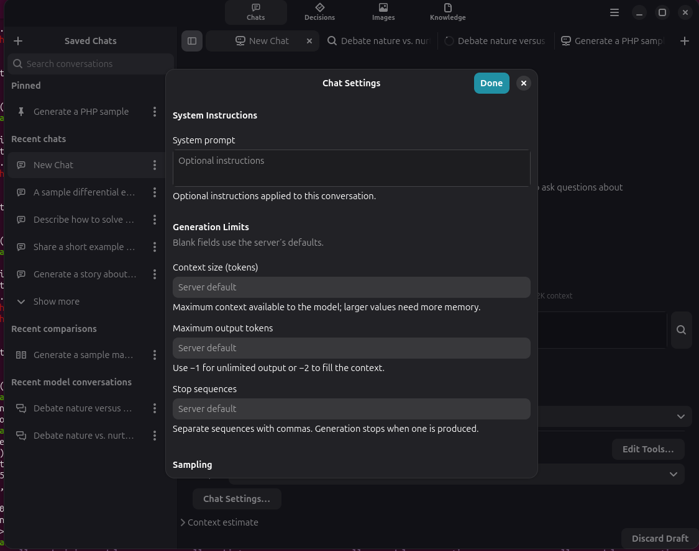
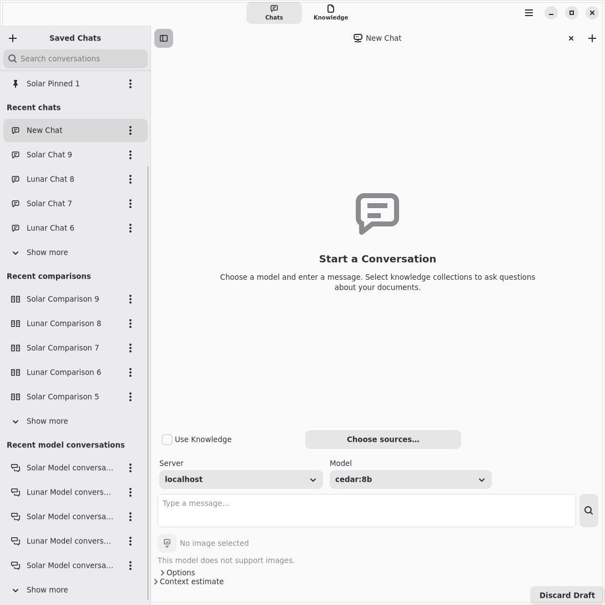
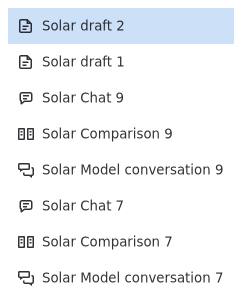
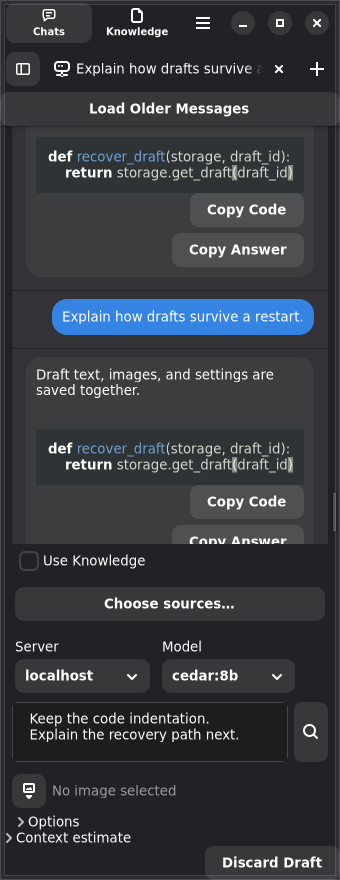

# Chats and responses

The **Chats** section is where you talk to models. It holds multi-turn chats and single responses. [Comparisons](comparisons.md) and [model-to-model conversations](model-conversations.md) also live here and have their own pages.

## Chat and Response tabs

- **New Chat** starts a multi-turn conversation. Each turn is sent with the conversation so far, so the model keeps the context.
- **New Response** sends a single prompt with no history, which is useful for prompt engineering and testing. It uses Ollama's `/api/generate` and is available on Ollama servers and Ollama Cloud.

The host and model selectors stay visible at the top of every tab. Expand **Options** for thinking, tools, output formatting, and **Chat Settings…**; its label summarizes which controls are active.

## Writing prompts

Enter sends a prompt; Shift+Enter inserts a newline. The composer and the system instructions accept multiline text without stripping indentation.

### Attaching images

Attach one or more images to a prompt for vision-capable models.

- Paste a copied image, a screenshot, or an image file into the composer (Ctrl+V) to attach it. Clipboards that also offer plain text paste as text.
- Models that explicitly lack vision cannot receive new attachments. Earlier images stay visible and saved, but are left out of the history sent to those models, with a notice in the composer.
- Hosts without capability metadata keep manual image support, marked as unknown.

### Drafts

Unsent text, images, and settings are saved after 500 ms and flushed when the tab closes. Reopen an existing chat to recover its draft, or open **Drafts** in the sidebar for unsent Chat, Response, and Comparison editors. **Discard Draft** removes the saved draft. Completed Response output stays temporary and is not saved to history.

## Chat Settings

**Chat Settings…** opens an adaptive dialog for:

- system instructions
- generation limits and sampling (including Top K, Min P, and context size where the host supports them)
- [model retention](hosts-and-providers.md#model-retention)
- diagnostics such as token probabilities (logprobs)

Empty numeric fields keep the server defaults. Invalid values show an explanation beside the field.

## Reading responses

- **Markdown and code**: responses render Markdown, with code syntax highlighting from GTKSourceView 5. Copy actions keep literal code, including fenced Markdown. **Preview Markdown** is an optional rendering of that source.
- **Thinking**: models that think show their reasoning separately from the answer, with thinking controls that depend on the model.
- **Statistics**: expand the details below an answer for generation statistics, including cached prompt tokens, the finish reason, tokens per second, and logprobs when requested.
- **Stop**: stop a response at any time. The partial answer is kept in the chat history. Pending history writes finish before the application quits.
- **Long answers**: chat bubbles resize with the window. API details wrap, while code keeps its formatting and scrolls horizontally only when a line is wider than the window.

### Math

TeX in responses is typeset as equations that follow the theme's text colour and font size.

- **Display equations** (`\[ … \]`, `$$ … $$`, a bare `\begin{…}` environment, or a line that is only TeX) are centred on their own line, with a button to copy the TeX source.
- **Inline equations** (`\( … \)`, `$ … $`) are drawn within the text, including inside tables. Prices such as `$5` and anything in code are left as written.
- Selecting and copying text copies a placeholder character for each inline equation rather than its TeX.

## Long conversations

Conversations first show their latest 50 messages. **Load Older Messages** loads earlier ones while keeping your reading position. During generation, scroll upward to stop following the response; use **Jump to latest** to resume.

## History and the sidebar

Every chat, comparison, and model conversation is saved automatically, together with its model settings.

The Chats sidebar separates **Recent chats**, **Recent comparisons**, and **Recent model conversations**; pinned items share **Pinned**, and unsent editors appear under **Drafts**. Each category shows its five most recently updated entries, each with its own icon. **Show more** expands a category to its full list; **Show less** returns to five. Categories with five or fewer entries need no expansion control. Library lists load in pages of 100.

Use the three-dot menu on any saved item to **Pin**, **Rename**, or **Delete** it.

### Search

Search filters every category as you type, including entries hidden by the five-item limit. It searches titles, user and assistant messages, and draft text using literal token prefixes.

- Matching message passages appear below conversation titles. Selecting a conversation opens it at its matching message.
- The autocomplete menu suggests titles: choose one with the mouse, or use Up/Down followed by Enter or Tab, to fill the search field. Escape dismisses the suggestions.
- Each filtered category can expand independently. Clearing the search restores your previous expansions.

### Export

The conversation menu exports **Markdown** or versioned **JSON** after pending saves finish. JSON preserves settings, thinking, outcomes, tool rounds, retrieval snapshots, and embedded attachments. Credentials and their references are never included.

## Navigation

The header switches between four sections: **Chats**, **Decisions**, **Images**, and **Knowledge**. Chats, Decisions, and Images each have their own tabs and their own sidebar, with its own search and its own Drafts and Pinned groups. Starting or reopening a decision or an image shows its section.

- Tabs can be reordered and show a loading indicator while a response is running.
- Sidebars collapse on narrow windows.
- **Ctrl+W** closes a tab, **Ctrl+Page Up/Down** switches tabs, and **F9** toggles the sidebar in the section shown.

