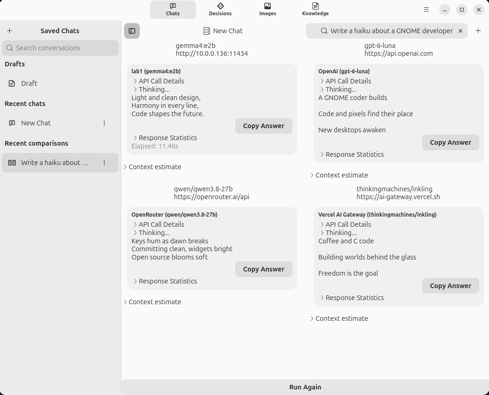

# Comparisons

A comparison sends one prompt to several models at once and shows their answers side by side.

## Running a comparison

Choose **New Comparison** (Ctrl+Shift+N) and pick 2–4 distinct host/model pairs. The models can be on different hosts, local or cloud. All targets share:

- the prompt and system instruction
- generation settings
- attached images
- one [knowledge](knowledge.md) retrieval snapshot, so every model sees the same sources

If a setting doesn't suit one of the targets, the draft stays available so you can correct it. Stop individual targets, or use **Stop All**.

## Layout

Responses fill equal columns on wide windows and use a target switcher on narrow windows. Bubbles resize with the window; API details wrap, while code keeps its formatting and scrolls horizontally only when a line is wider than its column.

## History

Results stay together in history under **Recent comparisons**, with pin, rename, search, delete confirmation, and Markdown/JSON export. Unsent comparisons appear under **Drafts**. Reopening a result sends no requests; **Run Again** creates a new editor and run.
