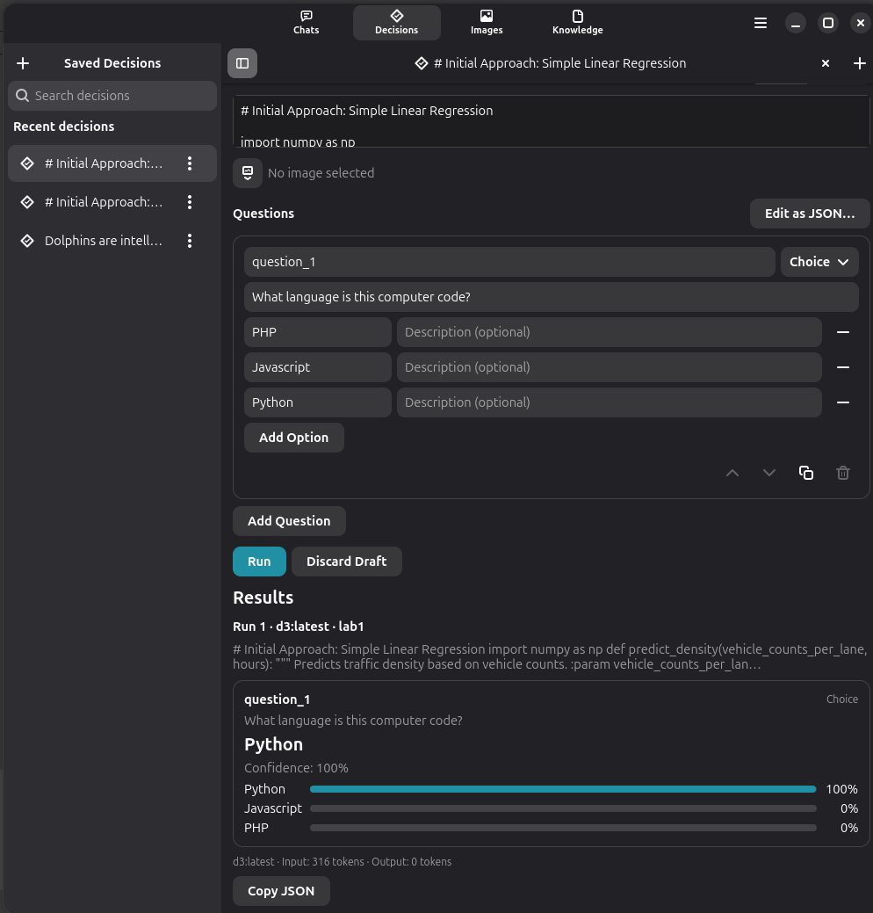

# Decisions

The **Decisions** section puts structured questions to a *decision model*. A decision model writes no text: it is sent a state and a set of named questions, and returns a named answer with probabilities for each.

Decision models are offered by Ollama servers, LM Studio, OpenAI, OpenRouter, and the Vercel AI Gateway (see [what each host type supports](hosts-and-providers.md#what-each-host-type-supports)). They are listed in this section only, never in a chat, comparison, or model conversation.

## Asking questions

Choose **New Decision** (Ctrl+Shift+E). Enter the state as **Text** or **JSON**, attach images if the model takes them, and build the questions in the form. Each question has a name, a type, optional instructions, and criteria for its type:

| Type | Criteria | Answer |
| --- | --- | --- |
| **Yes/No** | Optional descriptions of what counts as yes and as no | The probability of yes |
| **Choice** | 1–255 named options, each with an optional description | One option, with every option's probability |
| **Score** | 1–10 levels, from lowest to highest | A score with its distribution |
| **Box** | Where something is in an image. Offered for models that answer it; needs exactly one image | A box drawn over the image |

**Edit as JSON…** shows the same questions as JSON, to edit, import, or export.

## Running

**Run** sends the request and adds a result with a card for each question, the model that answered, token counts, and the cost where the server reports one. **Stop** cancels a run.

Anything the selected model cannot be sent, such as an image, a box question, or more questions than it accepts, holds **Run** back and explains why. Nothing is silently left out of a request.

## Images

Some models accept only images of certain sizes. A note appears when an image for a box question is under 256 or over 1568 pixels on a side, and a model's own refusal is shown as the run's error. OpenAI, OpenRouter, and the Vercel AI Gateway take PNG and JPEG, so other formats are converted to PNG before they are sent.

## History

Every run is saved in its session with its state, images, questions, and answers. Sessions appear in the **Decisions** section under **Recent decisions**, with drafts, search over the state of each run, pinning, rename, deletion, and Markdown/JSON export. Reopening a session sends nothing.
