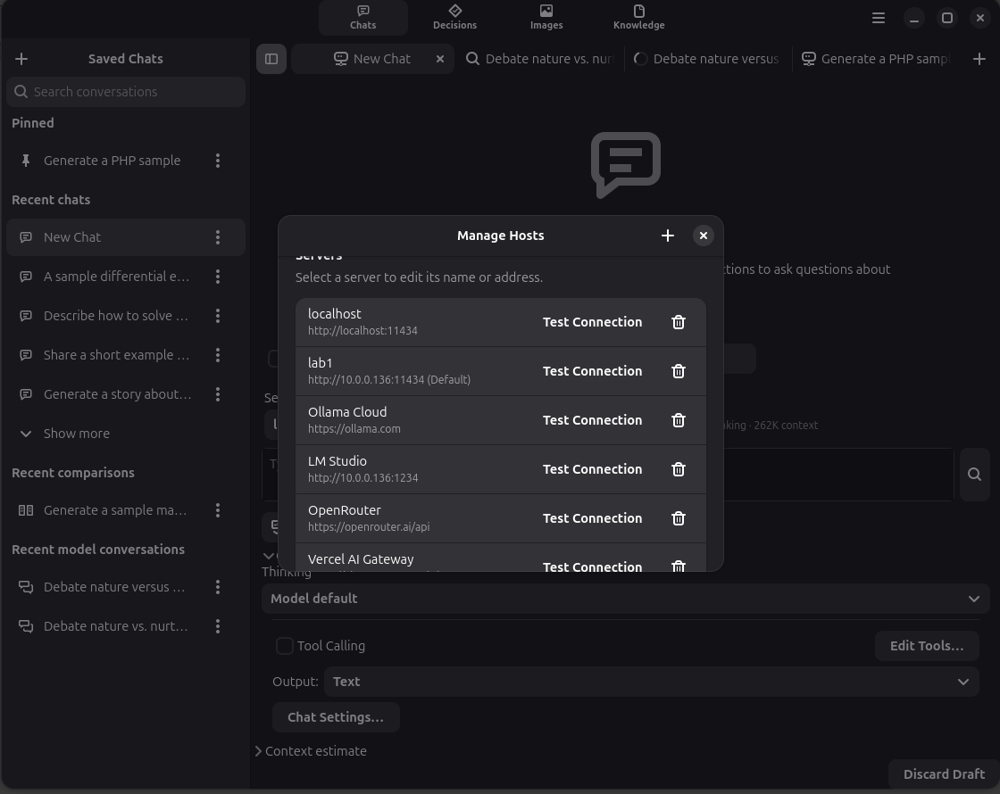
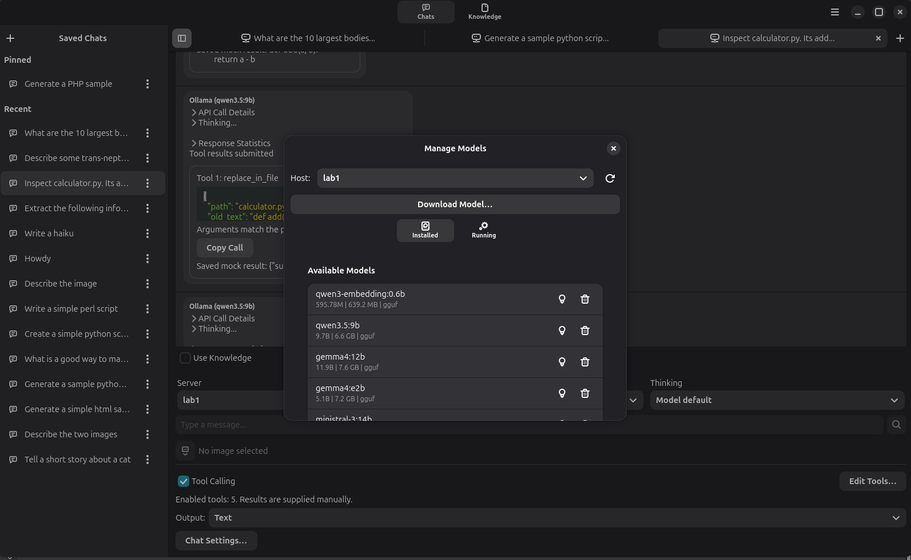

# Hosts and providers

A *host* is where Tureen sends requests: a model server on your computer or network, or a cloud service reached with an API key. You can add as many hosts as you like, mix local and cloud hosts, and choose a different host in every tab.

## Adding a host

Open **Manage Hosts**, add a host, and choose its type. Give it a name you will recognize in the host selectors, fill in the address if the type needs one, and save. Select any host in a Chat, Response, Comparison, Model Conversation, Decision, or Image tab. One host can be marked as the default for new tabs.

| Host type | Address | API key | Where to get a key |
| --- | --- | --- | --- |
| **Ollama Server** | Your server, e.g. `http://localhost:11434` | Not needed | — |
| **LM Studio** | `http://localhost:1234` by default; enable the server in LM Studio's Developer tab | Optional | Only if you turned on authentication in LM Studio |
| **Ubuntu Inference Manager** | `http://localhost:8400` by default | None | — |
| **OpenAI-Compatible Server** | Your server, e.g. `http://localhost:8080` (`/v1` is added if needed) | Optional | Whatever your server expects |
| **Ollama Cloud** | Filled in automatically | Required | [ollama.com/settings/keys](https://ollama.com/settings/keys) |
| **OpenAI** | Filled in automatically | Required | [platform.openai.com/api-keys](https://platform.openai.com/api-keys) |
| **OpenRouter** | Filled in automatically | Required | [openrouter.ai/keys](https://openrouter.ai/keys) |
| **Vercel AI Gateway** | Filled in automatically | Required | Your Vercel dashboard, under **AI Gateway → API Keys** |

Host records keep their name and address labels, validate the address as you type, and show a **Test Connection** action.

**Test Connection** lists the host's models. For Ubuntu Inference Manager it first checks that the address really is that service, and suggests the OpenAI-Compatible Server type if it isn't. For OpenAI and the Vercel AI Gateway it also confirms the key is accepted. Ollama Cloud and OpenRouter publish their model lists, so for them a successful test confirms only that the service is reachable, and the key is checked when you first generate a response.

## What each host type supports

| | Ollama Server | LM Studio | Ubuntu Inference Manager | OpenAI-Compatible | Ollama Cloud | OpenAI | OpenRouter | Vercel AI Gateway |
| --- | :-: | :-: | :-: | :-: | :-: | :-: | :-: | :-: |
| Chat, tools, thinking | ✓ | ✓ | ✓ | ✓ | ✓ | ✓ | ✓ | ✓ |
| Structured output | ✓ | ✓ | ✓ | ✓ | | ✓ | ✓ | ✓ |
| Single responses (`/api/generate`) | ✓ | | | | ✓ | | | |
| Embeddings for Knowledge | ✓ | ✓ | ✓ | ✓ | | ✓ | ✓ | ✓ |
| Image embeddings | ✓ | | | ✓ | | | ✓ | |
| Decisions | ✓ | ✓ | ✓ | | | ✓ | ✓ | ✓ |
| Image generation | | | | | | ✓ | ✓ | ✓ |
| Pull, delete, and unload models | ✓ | | | | | | | |
| Model retention | ✓ | | | | | | | |

Model names come directly from each host. Image input, tool calling, and thinking controls follow each model's reported capabilities. OpenAI-compatible servers don't report these, so Tureen doesn't check them there; hosts without capability metadata keep manual image support, marked as unknown. If a tab uses a setting the selected host can't take, such as structured output on Ollama Cloud, Tureen names it instead of sending the request. The setting stays saved in the tab for hosts that support it.

### Ubuntu Inference Manager

[Inference Manager](https://github.com/canonical/inference) (the `inference` snap) serves every model installed through it at one address, `http://localhost:8400`, with no API key. Models are listed as `provider/model`, for example `smollm2/smollm2-135m`.

The server doesn't say what its models can do, so Tureen reads the catalogue the service keeps on its machine, `/var/snap/inference/common/onboarded-snaps.json`, and the installed providers' model manifests under `/snap`, which tell which catalogue model each served name is. That gives each model's image, tool, and thinking support, its quantization, and its size on disk, and marks embedding models so they are offered only in **Knowledge**. Thinking can be turned on or off. Text for **Knowledge** is split into pieces of at most 512 tokens, the most the service's embedding servers accept in one input. Decision models, such as Clef Flash, are offered in **Decision** tabs. They need instructions on every question, and they don't answer box questions. Models the catalogue doesn't list, and every model when the file can't be read (for example from the Flatpak build), are used with their capabilities unknown, as on any OpenAI-compatible server. Context length isn't reported, so your own setting applies.

If no models are listed, install one on the server, for example `sudo inference install gemma4`. A provider that is stopped (`sudo snap stop <provider>`) drops out of the list until it is started again.

A provider's server sizes the model's context to the memory that is free, so a model can take far more memory than its size on disk: on a 16 GB computer, Qwen 3.5 4B took 12 GB. Installing a provider installs its default model; choose a smaller one with the provider's own command, for example `sudo qwen3-5 use-model qwen3.5-0.8b`, then `qwen3-5 prune-cache`.

### Model lists

Model lists appear before capability checks, and only the selected model is checked. Models known to be embedding-only are left out of every generation mode, but stay available in **Knowledge** and **Manage Models**. Decision and image models are listed only in their own tabs. Opening an empty model selector retries discovery. Unknown capabilities remain supported for older servers.

## API keys

Keys are stored through libsecret in the desktop keyring (using its portal backend in Flatpak), separately from the host database and conversation history. They are never written to the database or included in exports.

- Leave the key field blank when editing a host to keep its existing key.
- If the keyring is unavailable, **Use for This Session** keeps the entered key in memory until Tureen exits. After restarting, enter it again unless a previously saved key is available.
- Removing a host also removes its saved key. A keyring failure leaves the host in place so you can retry.

## Managing models on Ollama servers

**Manage Models** works with Ollama servers:

- **Download Model…** pulls a model, with a progress bar and expandable download details.
- Delete models you no longer need. When a model has been used for knowledge embeddings, the confirmation reports the affected documents, indexes, and vectors; see [Knowledge and RAG](knowledge.md#deleting-embedding-models).
- View model details, including size, parameters, Modelfile, template, and license.
- Switch between **Installed** and **Running** models for the selected host. Running models show memory, VRAM, context length, and expiry, and refresh every five seconds while that view is visible.
- **Unload** a running model to free its memory while keeping its downloaded files. Unload is unavailable while Tureen has an active response using the model.

Cloud hosts show their available models without download, deletion, running-model, or unload controls.

## Model retention

On Ollama servers, **Chat Settings…** sets how long a model stays loaded after a request: the server default, unload after the reply, five or thirty minutes, indefinitely, or a custom duration in seconds. The setting applies to requests from that tab. Ollama Cloud manages model retention itself.
