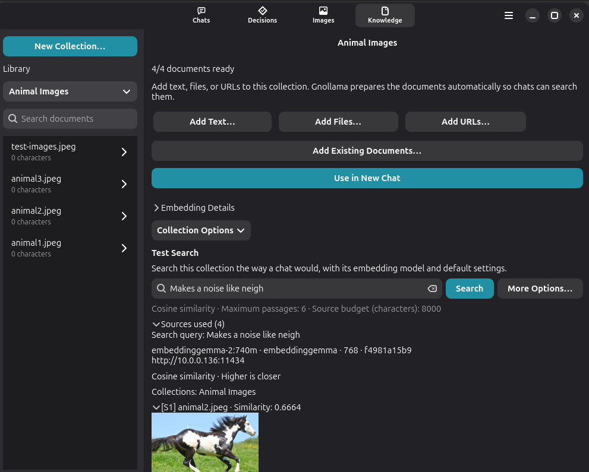

# Knowledge and RAG

The **Knowledge** section is a local library of documents that chats can draw on. You import text, PDFs, web pages, and images, group them into collections, and turn them into embeddings. A chat that uses a collection searches it on every turn and gives the model the most relevant passages as sources (retrieval-augmented generation, or RAG).

Document text and vectors are stored locally in Tureen's database. The embeddings can be made by any host that offers embedding models, and the model answering the chat can be on a different host.

## Getting started

1. **Pick a host with an embedding model.**
   - On an Ollama server, use **Manage Models** to pull one, such as `qwen3-embedding:0.6b` or `embeddinggemma`.
   - In LM Studio, download one in LM Studio itself.
   - OpenAI, OpenRouter, the Vercel AI Gateway, and OpenAI-compatible servers list the embedding models they offer, such as `text-embedding-3-small`.
   - Ollama Cloud has no embedding models.

   With a cloud host, the document text and images are sent to that service to be embedded. Use a local host for anything that must stay on your machine.
2. **Create a collection.** Switch to **Knowledge**, which opens on **Collections**. Choose **New Collection…**, enter a name, and select the embedding host and model. Model-specific formatting defaults are selected automatically. Prefixes, dimensions, and chunk settings are under **Advanced Embedding Settings**.
3. **Add documents.** Open the collection and choose **Add Text…**, **Add Files…**, or **Add URLs…**. **Add Files…** takes PDFs, UTF-8 text files (including Markdown and source code), and images (PNG, JPEG, GIF, WebP) when the collection's embedding model accepts images. Every import shows its destination collection and can create a new collection without leaving the dialog. Review the content, then choose **Add to Collection**. Files are reviewed one at a time in a single queue; skip unsupported files and continue with the rest.
4. **Wait for documents to be ready.** Documents prepare automatically, reusing compatible embeddings. Watch the status change to **Ready**. Failures show their cause and can be retried with **Prepare Documents**.
5. **Choose sources for a chat.** Choose **Use in New Chat** on a ready collection, or open a Chat tab's **Choose sources…**. The first collection you select determines the embedding configuration and the default host and model; compatible collections can be combined. Host overrides, similarity measures, thresholds, and retrieval limits are under **Search Settings**. **Test Search** previews retrieval without sending a chat message.
6. **Chat.** Enable **Use Knowledge** in the Chat tab. Each new turn resolves the current collection membership before searching. Every selected collection must be nonempty and fully indexed; otherwise Tureen explains which sources need attention and keeps your draft. The expandable **Search Query Override** can make a follow-up question self-contained without changing the chat message.

### A quick example

Create a collection and paste: `The maintenance window is Sunday from 02:00 to 04:00 UTC. Contact the infrastructure team to request an exception.` Wait for its embeddings to complete, select the collection in a chat, and ask: `When is the maintenance window?` Expand **Sources used** to inspect the exact passage supplied to the model.

## The library and collections

The library holds every imported document. Collections are named groups of library documents; one document can belong to several collections without duplicating its text or compatible vectors.

- **Add Existing Documents…** adds library documents to a collection.
- **All Documents** and **Ungrouped Documents** are available in the Library selector.
- Collection names and membership can change at any time.
- Removing a document from a collection, or deleting a collection, keeps the library documents and their embeddings.
- Deleting an individual embedding index leaves its collections needing a rebuild.
- Cancelling a shared build affects every collection using it. Interrupted builds need an explicit retry after restarting.

Under **Collection Options**:

- **Copy with New Settings** changes a collection's embedding model, prefixes, dimensions, or chunk settings by making a new collection. The original collection and its chats are preserved.
- **Change Embedding Model** selects a model with the same identity (digest or fingerprint), including on another host that reports the same model.

## Importing

### Text and files

Paste text with **Add Text…**, or import files with **Add Files…**. Tureen stores the extracted text and page locations; it does not copy original files or modify them.

- For pasted text and local files, import revisions as new documents. Importing duplicate text offers to open the existing document instead.
- PDF page extraction can lose layout. Pages without text are reported. OCR and password-protected PDFs are not supported.
- Imports are limited to 50 MiB per file, 2,000 PDF pages, and 5 million extracted characters per document.

### Images

Image documents are embedded directly as images, so they need a multimodal embedding model; see the image embeddings row in [what each host type supports](hosts-and-providers.md#what-each-host-type-supports). If the chosen model doesn't accept images, Tureen says so instead of embedding them.

### Web pages

Choose **Add URLs…**, select a destination collection, and paste up to 20 HTTP/HTTPS URLs, one per line. **Fetch URLs** downloads two pages at a time. Select a row to review its title and extracted text, then **Add to Collection**, **Skip**, or **Fetch Again** (or **Retry** after a failure). A failed URL does not stop the other pages. Saving starts the collection's embedding build. Closing the dialog discards unsaved previews and cancels unfinished downloads; saved documents remain in the library.

**Extraction.** HTML extraction keeps a marked main or article region, removes navigation and other surrounding content, and uses Trafilatura when no main region is identified. Headings, lists, tables, links, and code are stored as Markdown. If the result needs adjustment, expand **Refine Extraction**, enter a **CSS selector** such as `main`, `article`, `.article-body`, or `#content`, and choose **Re-extract**. Matching regions are taken in document order without repeating nested matches. You can also edit the title and text directly. An invalid selector leaves the previous preview in place. PDF and UTF-8 text links use the file extractors; editing PDF text removes its original page-number mappings.

**Limits.** Only the downloaded content is processed: there is no crawling of linked pages, JavaScript execution, login session, or automatic refresh. For JavaScript-only pages, copy their text into **Add Text**. Downloads have a 60-second deadline, a five-redirect limit, and a 50 MiB limit including decompressed content. The text and PDF extraction limits above also apply. Temporary downloads use a 200 MiB batch cache; save or skip pages to free space if fetching pauses.

**Updating.** Web documents show their source URL, fetch date, and a **Fetch Again…** action. Reimporting the same requested URL updates that document; different URLs stay independent even if their text matches.

- Unchanged text reuses the existing vectors.
- Changed text needs a **Replace and Rebuild** confirmation, which names the affected collections. Replacement clears the obsolete vectors and rebuilds the existing indexes with their original model and chunk settings.
- Affected collections cannot be searched until rebuilding succeeds; failed builds can be retried.
- Saved chat answers keep their original passages and source metadata.
- A document with queued or running embedding builds must finish them before it can be replaced.

## Embedding configurations

An embedding configuration fixes the model's identity, the vector dimensions, and the document and query prefixes. Searches must use the same configuration that built the index.

### Model identity

A matching model name alone is not enough if the model itself has changed.

- On Ollama hosts, the identity is the model's content digest.
- Other hosts don't publish a digest, so Tureen uses a fingerprint of what the host reports about the model: its ID, and its variant or creation date where available. A replacement model that reports the same details would go unnoticed, and Tureen says so when you choose such a model.

### Presets and prefixes

Some embedding models expect an instruction before each document or query. Built-in presets cover plain input, EmbeddingGemma retrieval, Nomic retrieval, and Qwen3 retrieval; custom prefixes are also available. The Qwen3 preset leaves documents plain and adds its retrieval instruction to queries. Existing configurations keep their saved prefixes.

### Dimensions and chunks

Dimensions must be between 1 and 8,192. The defaults are the model's native dimensions and paragraph-aware chunks of up to 1,600 characters with 200 characters of overlap.

### Text that is too long

Text that is too long for the embedding model is never silently cut short.

- Ollama is sent `truncate=false`, so it refuses oversized chunks. Those are split further, and the actual boundaries are saved.
- Other hosts would shorten long input without saying so. For them, Tureen estimates each chunk's tokens against the model's input limit, when the host reports one, and keeps a fifth of the limit in reserve. If a chunk or search query is too long, Tureen stops and asks for a smaller chunk size or a shorter query.

## Searching

### Retrieval settings

Retrieval defaults to six passages and an 8,000-character source budget, with no minimum similarity. These controls are separate from generation settings. Character budgets are not token limits: leave room in the chat model's context for history, tools, and the answer. Similarity is a ranking score, not a measure of confidence.

The model is instructed to favor the supplied sources, cite passages when the response format allows it, and say when evidence is missing. This does not guarantee factual accuracy or that citations are followed.

### Similarity measures

| Measure | Closest match | Optional cutoff |
| --- | --- | --- |
| Cosine similarity (default) | Higher similarity, from −1 to 1 | Minimum similarity |
| Euclidean distance (L2) | Lower distance | Maximum distance, zero or greater |
| Manhattan distance (L1) | Lower distance | Maximum distance, zero or greater |

Switching measures clears the cutoff because its units change. Tureen stores normalized vectors, so Euclidean and cosine usually produce the same ranking; Manhattan sums absolute component differences and can rank differently. The selected measure and the actual scores are saved with each answer and shown in **Sources used**. Older snapshots without a measure are treated as cosine. Switching measures needs no re-embedding or database migration.

The library uses exact search with sqlite-vec and needs no separate vector database service. Every measure filters sources before ranking, with deterministic ties. Euclidean and Manhattan can be slower for large collections. Embedding the query adds time that depends on the model and host. See [Development](development.md#retrieval-performance) for implementation details and benchmarks.

## Answers and sources

The original prompt stays visible and saved. With each turn, Tureen saves the exact retrieved passages, their locations and scores, the embedding configuration, the search query, and the resolved collection names and membership.

- Collection changes affect future questions; earlier answers keep their original sources.
- Only that turn's passages are added to the outgoing context.
- Tool-call continuations reuse the same snapshot, even after reopening the chat.
- JSON and JSON Schema output remain supported, with source information in a separate panel rather than extra schema fields.

If retrieval fails or selected sources disappear, the prompt stays in the composer. Adjust the sources, retry, or explicitly choose **Send Without Knowledge**. Changing the selection affects later turns. Applied selections persist even in chats closed before their first prompt.

Older chats may keep individual document or chunk selections. They keep working until replaced; **Choose sources…** explains that applying collections replaces those older sources. Closing the dialog leaves the saved selection unchanged.

## Deleting embedding models

When you delete a model from an Ollama server in **Manage Models**, the confirmation reports the affected documents, indexes, and vectors. Data is kept by default. The optional vector-cleanup checkbox removes matching indexes across the hosts that created them, while keeping the source text. Historical chat passages remain saved.

Deleting a model outside Tureen, or a cloud service retiring one, never deletes library data automatically. Refresh the library to check availability, select a compatible host, or build replacement indexes. Active embedding jobs count as busy in the model manager's checks.

## Storage

Extracted text and page locations are kept in Tureen's local SQLite database. Normalized float32 vectors are stored only in sqlite-vec virtual tables, one per embedding configuration. See [Data and upgrades](data-and-upgrades.md) for where the database lives and how upgrades work.
