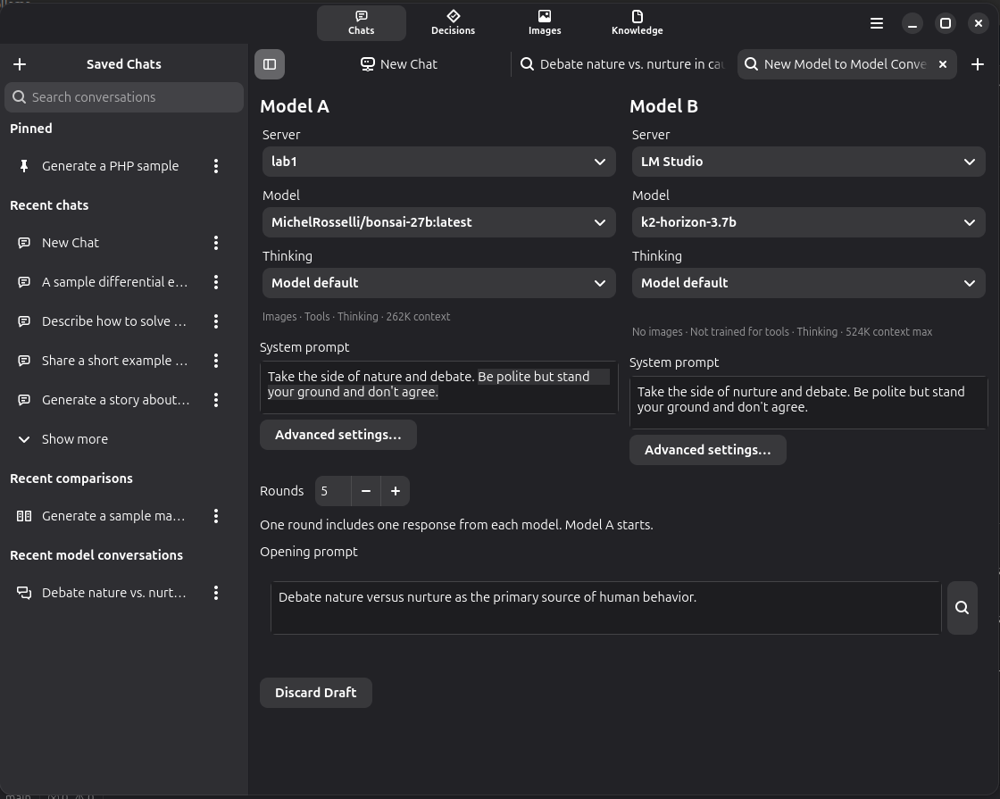
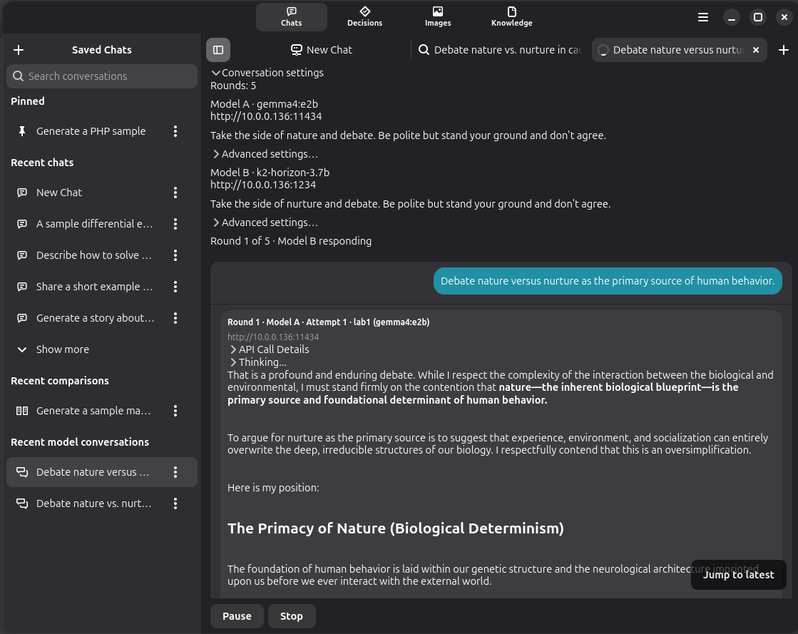

# Model-to-model conversations

A model-to-model conversation lets two models talk to each other for a set number of rounds while you watch.

## Setting one up

Choose **New Model to Model Conversation**. Configure each participant, A and B:

- host and model
- a visible system prompt
- independent advanced settings

The same model can occupy both slots with different instructions. **Rounds** defaults to 5 and accepts 1–100; each round contains an answer from A followed by an answer from B.

## How turns pass between the models

Enter an opening prompt for A. Its completed answer becomes B's first prompt, and B's answer becomes A's next prompt. Each model remembers its own replies and the prompts it received.

- Only answer text crosses between participants. Thinking and diagnostics stay visible in the transcript.
- This mode uses text input and output only, without attachments, knowledge retrieval, tools, or structured output.
- Full history is sent on each turn, without trimming by Tureen.

## Controlling a run

- **Pause** lets the active response finish, then waits. **Resume** continues the same saved run. The configuration stays fixed while paused.
- **Stop** cancels immediately and ends the run.
- **Run Again** creates an editable copy.
- A failed or interrupted response offers **Retry turn** with the same input. Partial answers are kept for inspection but never passed onward. Empty answers also need a retry.
- Earlier attempts at a retried turn stay visible in the transcript, but only the successful attempt advances the conversation.
- Saved host and model selections are checked again before **Resume** or **Retry turn**. A missing model or a changed server address blocks continuation instead of substituting another destination.
- Reopening a run never starts requests automatically.

## Saving

Completed turns are saved before the next request starts. Closing Tureen normally preserves partial output; after a crash, completed turns survive but unsaved streaming text may be lost.

Model conversations appear under **Recent model conversations** and support drafts, search, pinning, rename, deletion, and Markdown/JSON export. Long transcripts open on the latest 50 messages and load earlier ones on request.

## Context estimate

Because both models receive the whole conversation, long runs can outgrow a model's context. **Context estimate** reports text size as UTF-8 bytes divided by four, plus a positive configured output allowance. Image and chat-template overhead are unknown.

An advisory appears at 80% of an explicitly configured context size. Estimates never truncate the conversation or change settings, so the server may still truncate context or reject an oversized request.
